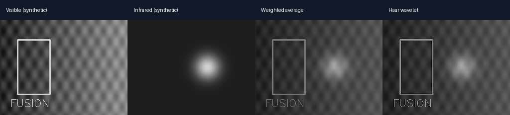
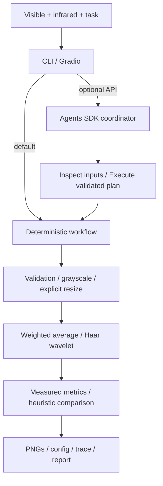

# FusionAgent

**An Agentic Workflow for Infrared and Visible Image Fusion**

[中文说明](README_zh.md) · [Verification](docs/VERIFICATION.md)

Upload a registered visible/infrared pair, compare CPU fusion baselines, inspect measured statistics,
and export a traceable report. An optional OpenAI Agents SDK coordinator interprets task preferences
and invokes bounded tools. The deterministic path works locally without an API key.



These are actual algorithm outputs on synthetic shapes, **not real sensor data or a benchmark**.
A UI GIF is not yet recorded; see [capture checklist](docs/DEMO_CHECKLIST.md).

## Features and architecture

- Image decoding, format/depth/channel checks, blank warnings, source SHA256 hashes.
- Weighted average and one-level Haar wavelet fusion; grayscale, CPU-only.
- Four no-reference metrics, transparent heuristic comparison, Pydantic contracts.
- Per-tool timings, unique run folders, PNGs, Markdown/JSON report and versioned configuration.
- CLI and local Gradio uploads, original previews, fusion gallery, metric table, trace and download.
- Optional single Agent, no-key fallback, four repository Skills, Pytest/Ruff and CI configuration.



The agent receives task text and metadata/statistics, not pixels. Its tools bind the user-selected
paths and allowed methods; resizing needs explicit user permission through a flag. It inspects
before executing at most one experiment, with a six-turn limit. Python generates the authoritative
report; separate `agent_summary.json` stores model prose that cannot override measured results.
There are no specialist-agent handoffs or trained neural models in this release.

## Install

Python 3.10+. NumPy handles arrays; OpenCV headless handles IO/grayscale/resize; PyWavelets handles
Haar transforms; Pydantic validates contracts. Extras: `dev` (Pytest/Ruff), `ui` (Gradio),
`agent` (OpenAI Agents SDK). PyTorch is **not used** by these baselines.

```bash
python -m venv .venv
```

Activate: `source .venv/bin/activate` on Linux/macOS, `.venv\Scripts\Activate.ps1` in PowerShell.
If activation is restricted, invoke `.venv\Scripts\python.exe` directly.

```bash
python -m pip install -e ".[dev,ui,agent]"
```

For CPU CLI only: `python -m pip install -e .`.

## Run without a key

```bash
python examples/generate_demo.py
python -m fusion_agent.cli --visible examples/visible.png --infrared examples/infrared.png --method both --output outputs/demo
python -m fusion_agent.cli --visible examples/visible.png --infrared examples/infrared.png --method wavelet --output outputs/wavelet
python app.py
```

Gradio binds to `127.0.0.1` without public sharing. Upload both images, type a task and run.
Without Agent mode, task text is recorded as context and does not change parameters.
`--method weighted --weight 0.7` retains 70% visible intensity. `--resize` bilinearly resizes
infrared to visible dimensions: **size matching is not geometric registration**.

Accepts PNG/JPEG/BMP/TIFF decoded as 8-bit grayscale or three-channel images. Color uses OpenCV
BGR-to-gray. Alpha and 16-bit inputs are rejected to avoid silent intensity changes. Limits:
minimum 2×2, maximum 16 megapixels and 32 MiB. Constant images generate warnings.

Each run prints `outputs/demo/run-<id>/report.md`. The unique folder also contains method PNGs,
`report.json` and `config.json` (plan, versions, seed, input hashes). Baselines have no stochastic
operations; seed 0 is recorded by convention. Run IDs and timings vary; images and metrics repeat.

## Optional Agent

`.env.example` is a template, not automatically loaded. Set variables in your shell:

```powershell
$env:OPENAI_API_KEY = "YOUR_KEY"
$env:OPENAI_MODEL = "gpt-4.1-mini"
python -m fusion_agent.cli --visible examples/visible.png --infrared examples/infrared.png --agent --task "Compare both methods and emphasize visible texture"
```

Linux/macOS: use `export OPENAI_API_KEY=...` and `export OPENAI_MODEL=...`.
Select a model available to your API account; access and API charges depend on that account.
Missing key produces `deterministic-fallback-no-key`. Provider errors are sanitized, with possible
partial local output. SDK tracing is disabled in code. Task text, basenames, dimensions, hashes,
warnings and metrics may reach the API; raw pixels and absolute output paths are not sent.
Avoid sensitive task text and filenames. Local acceptance did not make a paid live API call.

## Algorithms and metrics

Weighted fusion: `round(w*V+(1-w)*I)`, clipped to [0,255]. Haar fusion averages approximation
coefficients and selects signed detail coefficients with larger absolute magnitude (visible wins
ties), using one level and symmetric extension. Inverse output is cropped for odd dimensions,
rounded and clipped. These are interpretable baselines, not state-of-the-art claims.

All statistics use the final 8-bit grayscale image X in [0,255]:

| Metric | Definition | Reference? | Limitation |
|---|---|---|---|
| Entropy | `-sum(p*log2(p))`, 256-bin histogram, bits | No | Noise raises entropy; ignores spatial structure |
| Std | Population `sqrt(mean((X-mean(X))²))` | No | Contrast is not semantic information |
| Average gradient | Mean `sqrt((dx²+dy²)/2)` on shared top-left `(H-1,W-1)` grid | No | Noise/sharpening can inflate it |
| Spatial frequency | `sqrt(mean(dx²)+mean(dy²))`, each on its valid difference grid | No | Sensitive to scale, noise and alignment |

Compare under identical scene, scaling and preprocessing. SSIM, source MI and VIF are not
implemented. The default recommends maximum average gradient, ties in execution order: a
**detail heuristic, not a quality verdict**. Inspect artifacts and target preservation separately.

Actual synthetic demonstration (one pair; not generalizable):

| Method | Entropy | Std | Average gradient | Spatial frequency |
|---|---:|---:|---:|---:|
| weighted | 6.1246 | 22.5674 | 2.5471 | 12.2605 |
| wavelet | 6.4233 | 24.7036 | 4.0870 | 21.1646 |

## Skills and tests

[AGENTS.md](AGENTS.md) requires `$dataset-audit` after data changes, `$fusion-experiment` after
algorithm changes, `$result-analysis` for interpretation, and `$project-verification` after
significant changes and before commits. Each skill has instructions and an executable wrapper;
canonical deterministic scripts live in `scripts/`.

```bash
python .agents/skills/dataset-audit/scripts/audit.py --root examples
python .agents/skills/fusion-experiment/scripts/experiment.py --visible examples/visible.png --infrared examples/infrared.png
python .agents/skills/result-analysis/scripts/analyze.py outputs/demo/run-REPLACE/report.json
python .agents/skills/project-verification/scripts/verify.py
python -m ruff check .
python -m ruff format --check .
python -m pytest -q
```

Replace `run-REPLACE` with the printed folder. Dataset audit supports matching stems in
`DATASET/visible/` and `DATASET/infrared/`, reporting without changing sources.
CI installs the src-layout package on Python 3.10/3.12 and runs Ruff, tests and CLI.
Offline SDK tests exercise real tool schemas/invocations, not live model availability.

## Repository map

```text
src/fusion_agent/   schemas, workflow, cli, tools/, agents/, ui/
tests/             IO, algorithms, CLI, SDK and UI tests
examples/          original synthetic images and generator
scripts/           audit, experiment, analysis, verification
.agents/skills/    four executable repository Skills
docs/              progress, verification, model extension design, demo artifacts
.github/workflows/ CI
```

## Data, limitations, roadmap and license

Only original synthetic images are bundled under MIT. No external dataset is downloaded or
redistributed. Get public datasets from authors and check their license. Private research images,
datasets, outputs and weights must stay out of Git. Pixel limits are checked after decoding;
this is a local demo, not a hardened multi-tenant upload service.

Limitations: 8-bit grayscale, no registration/calibration, no learned models/training, no dataset
benchmark, no reference metrics, single coordinator, heuristic recommendation.
**Roadmap (not implemented):** PyTorch adapter via `FusionMethod`, licensed pretrained model
evaluation, color reconstruction, registration and downstream-task metrics.
See [model extension design](docs/MODEL_EXTENSION.md).

[MIT License](LICENSE). Thanks to NumPy, OpenCV, PyWavelets, Pydantic, Gradio, OpenAI Agents SDK,
Pytest and Ruff. References:
[OpenAI SDK](https://developers.openai.com/api/docs/guides/agents/quickstart),
[PyWavelets](https://pywavelets.readthedocs.io/en/latest/ref/2d-dwt-and-idwt.html),
[Gradio Blocks](https://www.gradio.app/docs/gradio/blocks).
