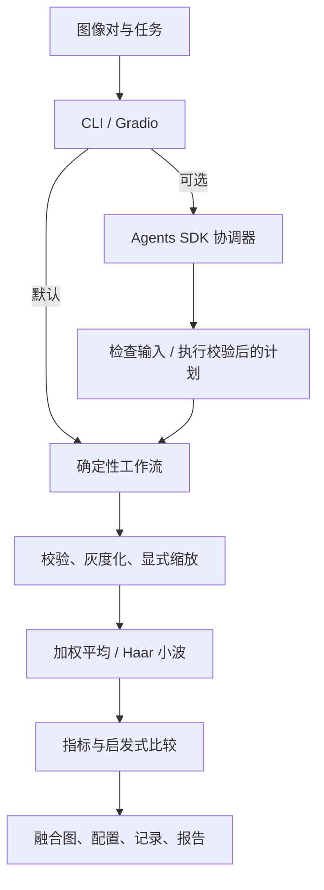

# FusionAgent：红外—可见光图像融合智能体系统

[English](README.md) · [简历与面试材料](docs/CAREER_NOTES.md) · [验收记录](docs/VERIFICATION.md)

输入一对已配准的可见光和红外图像及任务描述，完成 CPU 融合、指标对比与可追踪报告。
可选 OpenAI Agents SDK 协调器根据任务选择参数并调用工具；无 API 密钥也能运行完整流程。


图中数据是程序生成的形状与纹理，**不是真实红外数据，也不是性能基准**。
界面 GIF 尚未录制，见 [拍摄清单](docs/DEMO_CHECKLIST.md)。

## 功能与架构

- 图像解码、格式/位深/通道校验、空白警告、SHA256。
- 加权平均、一层 Haar 小波融合；灰度 CPU 算法。
- 信息熵、标准差、平均梯度、空间频率；透明启发式推荐。
- Pydantic 数据结构、工具计时、独立运行目录、配置、Markdown/JSON 报告。
- CLI、本地 Gradio 上传、原图预览、结果画廊、指标表、执行记录、报告下载。
- 可选单 Agent 与无密钥降级、四个仓库 Skills、Pytest/Ruff 和 CI 配置。



Agent 工具绑定用户输入路径与可用方法，先检查再执行一次实验，最多六轮；缩放须显式开启。
模型只看到文字和元数据，不看像素，不能声称视觉理解图片。实测报告由 Python 生成，
模型总结另存 agent_summary.json，不覆盖指标。当前没有多智能体分工、深度模型或训练。

## 安装与无密钥运行

Python 3.10+。NumPy 处理数组，OpenCV headless 负责 IO/灰度/缩放，PyWavelets 负责小波，
Pydantic 负责校验。扩展 `ui` 是 Gradio，`agent` 是 Agents SDK，`dev` 是 Pytest/Ruff。
当前基线**不使用 PyTorch**。

```bash
python -m venv .venv
```

PowerShell 激活：`.venv\Scripts\Activate.ps1`；Linux/macOS：`source .venv/bin/activate`。
激活受限时直接使用 `.venv\Scripts\python.exe`。

```bash
python -m pip install -e ".[dev,ui,agent]"
python examples/generate_demo.py
python -m fusion_agent.cli --visible examples/visible.png --infrared examples/infrared.png --method both --output outputs/demo
python -m fusion_agent.cli --visible examples/visible.png --infrared examples/infrared.png --method wavelet --output outputs/wavelet
python app.py
```

仅 CPU CLI 可安装 `python -m pip install -e .`。Gradio 监听 `127.0.0.1`，不创建公开分享链接。
上传两张图，输入任务并运行。确定性模式下任务文字仅记录，参数由控件或 CLI 决定。
`--method weighted --weight 0.7` 表示可见光权重 70%；`--resize` 双线性缩放红外到可见光尺寸，
**缩放不等于几何配准**，请自行提供已配准图像。

支持 8-bit 灰度或三通道 PNG/JPEG/BMP/TIFF，彩色经 BGR-to-gray 转换；拒绝 alpha 与 16-bit，
避免隐式强度归一化。图像最小 2×2，最大 1600 万像素、32 MiB，常量图警告。
输出路径为 `outputs/demo/run-<id>/`，内含 PNG、report.md、report.json、config.json。
配置保存参数、版本、种子和输入哈希，独立目录避免覆盖。算法没有随机过程，种子约定为 0；
运行 ID 和耗时不同，图像与指标可重复。

## Agent 与密钥

`.env.example` 仅为参考，不自动加载。请在自己的终端中设置环境变量：

```powershell
$env:OPENAI_API_KEY = "YOUR_KEY"
$env:OPENAI_MODEL = "gpt-4.1-mini"
python -m fusion_agent.cli --visible examples/visible.png --infrared examples/infrared.png --agent --task "比较两种方法，强调可见光纹理"
```

Linux/macOS 使用 `export OPENAI_API_KEY=...` 和 `export OPENAI_MODEL=...`。
模型须对你的 API 账号可用，计费和权限由账号决定。无密钥时标记为
`deterministic-fallback-no-key`；API 错误脱敏返回，可能保留已完成的本地输出。
代码禁用 SDK tracing。任务、文件名、尺寸、哈希、警告和指标可能发给 API；原始像素与绝对
输出路径不会发送。请勿在任务或文件名中写隐私。本地验收没有进行真实付费 API 调用。

## 算法与指标

加权平均：`round(w*V+(1-w)*I)`，裁剪到 [0,255]。小波：一层 Haar，对称边界，低频平均，
高频按绝对值取大并保留符号，平局选可见光；逆变换裁去奇数尺寸填充，再取整、裁剪。
二者为可解释基线，不宣称最先进性能。

指标均在最终 [0,255] 灰度图上计算：

| 指标 | 定义 | 需要参考图？ | 局限 |
|---|---|---|---|
| 信息熵 | 256 桶直方图 `-sum(p*log2(p))`，bit | 否 | 噪声增加熵，不描述空间结构 |
| 标准差 | 总体 `sqrt(mean((X-mean(X))²))` | 否 | 对比度不等于语义信息 |
| 平均梯度 | 公共左上 `(H-1,W-1)` 网格 `mean(sqrt((dx²+dy²)/2))` | 否 | 噪声、锐化可抬高数值 |
| 空间频率 | 各自有效差分区域 `sqrt(mean(dx²)+mean(dy²))` | 否 | 受尺度、噪声、配准影响 |

比较须统一强度范围、场景与预处理。未实现 SSIM、源图互信息、VIF。
默认推荐平均梯度最大者，平局按执行顺序，**只是细节优先启发式，不代表整体质量**；
目标保留与伪影需视觉或下游任务验证。

原创合成样例实测，仅代表一对图像：

| 方法 | 熵 | 标准差 | 平均梯度 | 空间频率 |
|---|---:|---:|---:|---:|
| weighted | 6.1246 | 22.5674 | 2.5471 | 12.2605 |
| wavelet | 6.4233 | 24.7036 | 4.0870 | 21.1646 |

## Skills、测试、目录

[AGENTS.md](AGENTS.md) 规定：改数据逻辑用 `$dataset-audit`，改融合用 `$fusion-experiment`，
分析结果用 `$result-analysis`，重要修改后和提交前用 `$project-verification`。
每个 Skill 有说明与脚本入口，复用 scripts/ 的确定性实现。

```bash
python .agents/skills/dataset-audit/scripts/audit.py --root examples
python .agents/skills/fusion-experiment/scripts/experiment.py --visible examples/visible.png --infrared examples/infrared.png
python .agents/skills/result-analysis/scripts/analyze.py outputs/demo/run-REPLACE/report.json
python .agents/skills/project-verification/scripts/verify.py
python -m ruff check .
python -m ruff format --check .
python -m pytest -q
```

把 run-REPLACE 换成实际目录。数据集审计支持 DATASET/visible/ 与 DATASET/infrared/ 的
相同 stem 配对，报告缺失、重复、损坏，不改原图。CI 配置在 Python 3.10/3.12 安装项目并
运行 Ruff、测试与 CLI。离线 SDK 测试不等于在线模型验收，见 [验证记录](docs/VERIFICATION.md)。

```text
src/fusion_agent/   schemas、workflow、cli、tools/、agents/、ui/
tests/             IO、算法、CLI、SDK、UI 测试
examples/          原创合成图与生成器
scripts/           数据审计、实验、分析、验证
.agents/skills/    四个可执行 Skills
docs/              进度、验收、简历、面试、演示图
.github/workflows/ CI
```

## 数据、局限与计划

只分发原创合成图，适用 MIT；没有下载或分发外部数据集。公开数据从作者渠道获取并检查许可。
不要提交真实简牍科研数据、权重或密钥；datasets、outputs 被 Git 忽略。像素限制在解码后检查，
本项目是本地演示，不是面向不可信上传的多租户服务。

限制：8-bit 灰度，无几何配准、深度模型、训练、数据集基准或参考指标，单协调器、启发式推荐。
**Roadmap（未实现）**：通过 FusionMethod 接入 PyTorch，评估授权预训练模型，颜色重建、真实
配准与下游指标。接口方案见 [简历与面试材料](docs/CAREER_NOTES.md)。

[MIT 许可](LICENSE)。感谢 NumPy、OpenCV、PyWavelets、Pydantic、Gradio、OpenAI Agents SDK、
Pytest 和 Ruff。官方参考见英文 README。
