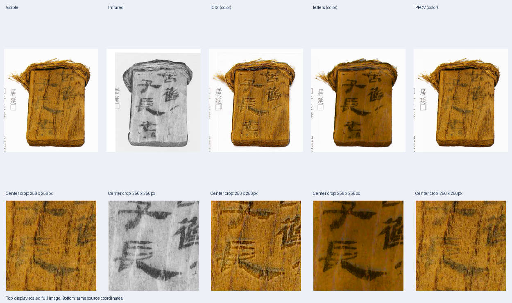
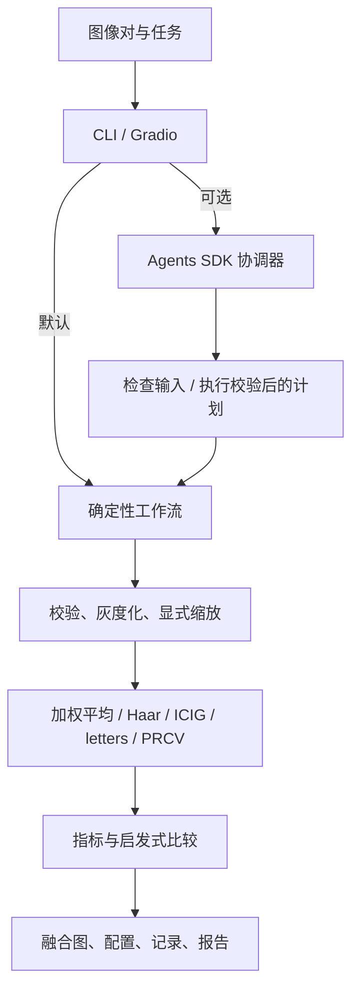

# FusionAgent：红外—可见光图像融合智能体系统

[English](README.md) · [验收记录](docs/VERIFICATION.md)

**[▶ 在线演示：点击即可试用](https://huggingface.co/spaces/hjt991202/fusion-agent)** ·
[全屏打开](https://hjt991202-fusion-agent.static.hf.space/) ·
[公开样例下载与来源](examples/tno/README.md)

**[▶ 查看 15 对简牍实测对比：ICIG + letters + PRCV](docs/JIANDU_RESULTS.md)** ·
[简牍原图与来源](examples/jiandu/README.md) · [本地模型安装](docs/RESEARCH_METHODS.md)

打开后选择样例，再点击“运行两种浏览器基线”。免费网页版在浏览器内计算，不需要登录或 API
密钥，也不会把你的图片上传到服务器。支持加权平均与 Haar 小波、四项指标、PNG/报告下载及三对真实 TNO
图片。在线简牍展示区包含 15 对原图和 ICIG、letters、PRCV 的**预计算实测结果**；深度模型在本地
Python 中运行，不提供在线 Agent。下方本地 Gradio 使用 Python，在线版基础算法使用 JavaScript；
加权平均灰度计算与 Python 一致，Haar 浮点舍入可能相差 1 灰度级。浏览器解码和颜色转换也可能
与 OpenCV 不同。见 [部署说明与范围](docs/DEPLOYMENT.md)。

输入一对已配准的可见光和红外图像及任务描述，完成 CPU 融合、指标对比与可追踪报告。
可选 OpenAI Agents SDK 协调器根据任务选择参数并调用工具；无 API 密钥也能运行完整流程。



图中是作者所提供权重的实际输出，不代表总体质量结论或独立测试集结果。全部 15 对对比图
已同步到 GitHub 仓库和 Hugging Face 在线演示。


图中数据是程序生成的形状与纹理，**不是真实红外数据，也不是性能基准**。
界面 GIF 尚未录制，见 [拍摄清单](docs/DEMO_CHECKLIST.md)。

## 功能与架构

- 图像解码、格式/位深/通道校验、空白警告、SHA256。
- 加权平均、一层 Haar 小波融合；灰度 CPU 算法。
- 接入 ICIG SparseGrFormer v3、letters IDRNet/边界细化和 PRCV IDRNet/VFC，支持彩色结果与权重追踪。
- 15 对原尺寸简牍 RGB/IR/Y 样例、来源记录和实测对比预览。
- 信息熵、标准差、平均梯度、空间频率；透明启发式推荐。
- Pydantic 数据结构、工具计时、独立运行目录、配置、Markdown/JSON 报告。
- CLI、本地 Gradio 上传、原图预览、结果画廊、指标表、执行记录、报告下载。
- 可选单 Agent 与无密钥降级、四个仓库 Skills、Pytest/Ruff 和 CI 配置。



Agent 工具绑定用户输入路径与可用方法，先检查再执行一次实验，最多六轮；缩放须显式开启。
模型只看到文字和元数据，不看像素，不能声称视觉理解图片。实测报告由 Python 生成，
模型总结另存 agent_summary.json，不覆盖指标。两个研究方法使用作者提供的预训练权重；
当前没有多智能体分工或训练流程，权重不进入 Git。

## 安装与无密钥运行

Python 3.10+。NumPy 处理数组，OpenCV headless 负责 IO/灰度/缩放，PyWavelets 负责小波，
Pydantic 负责校验。扩展 `ui` 是 Gradio，`agent` 是 Agents SDK，`dev` 是 Pytest/Ruff。
当前基线**不使用 PyTorch**。

```bash
python -m venv .venv
```

PowerShell 激活：`.venv\Scripts\Activate.ps1`；Linux/macOS：`source .venv/bin/activate`。
激活受限时直接使用 `.venv\Scripts\python.exe`。

```bash
python -m pip install -e ".[dev,ui,agent]"
python examples/generate_demo.py
python -m fusion_agent.cli --visible examples/visible.png --infrared examples/infrared.png --method both --output outputs/demo
python -m fusion_agent.cli --visible examples/visible.png --infrared examples/infrared.png --method wavelet --output outputs/wavelet
python app.py
```

仅 CPU CLI 可安装 `python -m pip install -e .`。Gradio 监听 `127.0.0.1`，不创建公开分享链接。
上传两张图，输入任务并运行。确定性模式下任务文字仅记录，参数由控件或 CLI 决定。
`--method weighted --weight 0.7` 表示可见光权重 70%；`--resize` 双线性缩放红外到可见光尺寸，
**缩放不等于几何配准**，请自行提供已配准图像。

支持 8-bit 灰度或三通道 PNG/JPEG/BMP/TIFF，彩色经 BGR-to-gray 转换；拒绝 alpha 与 16-bit，
避免隐式强度归一化。图像最小 2×2，最大 1600 万像素、32 MiB，常量图警告。
输出路径为 `outputs/demo/run-<id>/`，内含 PNG、report.md、report.json、config.json。
配置保存参数、版本、种子和输入哈希，独立目录避免覆盖。算法没有随机过程，种子约定为 0；
运行 ID 和耗时不同，图像与指标可重复。

## Agent 与密钥

`.env.example` 仅为参考，不自动加载。请在自己的终端中设置环境变量：

```powershell
$env:OPENAI_API_KEY = "YOUR_KEY"
$env:OPENAI_MODEL = "gpt-4.1-mini"
python -m fusion_agent.cli --visible examples/visible.png --infrared examples/infrared.png --agent --task "比较两种方法，强调可见光纹理"
```

Linux/macOS 使用 `export OPENAI_API_KEY=...` 和 `export OPENAI_MODEL=...`。
模型须对你的 API 账号可用，计费和权限由账号决定。无密钥时标记为
`deterministic-fallback-no-key`；API 错误脱敏返回，可能保留已完成的本地输出。
代码禁用 SDK tracing。任务、文件名、尺寸、哈希、警告和指标可能发给 API；原始像素与绝对
输出路径不会发送。请勿在任务或文件名中写隐私。本地验收没有进行真实付费 API 调用。

## 运行三种简牍方法

```bash
python -m pip install -e ".[research,ui]"
python scripts/import_research_weights.py --icig ICIGCode.zip --letters lettersCode.zip
python scripts/import_research_weights.py --prcv JDFusion.zip
python -m fusion_agent.cli --visible examples/jiandu/visible/jiandu_0239.png --infrared examples/jiandu/infrared/jiandu_0239.png --visible-y examples/jiandu/visible_y/jiandu_0239.png --method research --output outputs/jiandu
python scripts/demo_jiandu.py --output outputs/jiandu-demo-NEW
```

原压缩包由作者提供，未上传仓库。导入脚本仅提取经过 SHA-256 核对的权重到本地
`weights/`；也可通过 `FUSION_ICIG_WEIGHTS`、`FUSION_LETTERS_WEIGHTS`、`FUSION_PRCV_WEIGHTS`
指定权重。PRCV 来自 JDFusion.zip 中的 PRCV_Fusion_submit.zip，支持直接导入外层或内层压缩包。
方法名称沿用文件夹标识，不代表论文发表状态。新克隆用户无需权重即可运行基础算法和查看预览。
`--method icig` / `letters` / `prcv` 分别运行，`research` 比较三种简牍方法，`all` 比较五种方法；
原来的 `both` 仍指加权平均与 Haar。默认 CPU，另支持 `--device cuda`。
本地 Gradio 也可选择新算法，支持可选的可见光灰度图、有效区域与材料 mask。
详见 [算法与复现](docs/RESEARCH_METHODS.md)、[15 对样例](examples/jiandu/README.md)、
[实测展示](docs/JIANDU_RESULTS.md)。

## 算法与指标

加权平均：`round(w*V+(1-w)*I)`，裁剪到 [0,255]。小波：一层 Haar，对称边界，低频平均，
高频按绝对值取大并保留符号，平局选可见光；逆变换裁去奇数尺寸填充，再取整、裁剪。
二者为可解释基线，不宣称最先进性能。

指标均在保存的 [0,255] 灰度图上计算。ICIG 使用原始融合灰度图，其补充彩色恢复会调整亮度；
letters 和 PRCV 使用最终彩色图的 Pillow 灰度。比较时需要考虑这一输出语义差异：

| 指标 | 定义 | 需要参考图？ | 局限 |
|---|---|---|---|
| 信息熵 | 256 桶直方图 `-sum(p*log2(p))`，bit | 否 | 噪声增加熵，不描述空间结构 |
| 标准差 | 总体 `sqrt(mean((X-mean(X))²))` | 否 | 对比度不等于语义信息 |
| 平均梯度 | 公共左上 `(H-1,W-1)` 网格 `mean(sqrt((dx²+dy²)/2))` | 否 | 噪声、锐化可抬高数值 |
| 空间频率 | 各自有效差分区域 `sqrt(mean(dx²)+mean(dy²))` | 否 | 受尺度、噪声、配准影响 |

比较须统一强度范围、场景与预处理。未实现 SSIM、源图互信息、VIF。
默认推荐平均梯度最大者，平局按执行顺序，**只是细节优先启发式，不代表整体质量**；
目标保留与伪影需视觉或下游任务验证。

原创合成样例实测，仅代表一对图像：

| 方法 | 熵 | 标准差 | 平均梯度 | 空间频率 |
|---|---:|---:|---:|---:|
| weighted | 6.1246 | 22.5674 | 2.5471 | 12.2605 |
| wavelet | 6.4233 | 24.7036 | 4.0870 | 21.1646 |

## Skills、测试、目录

[AGENTS.md](AGENTS.md) 规定：改数据逻辑用 `$dataset-audit`，改融合用 `$fusion-experiment`，
分析结果用 `$result-analysis`，重要修改后和提交前用 `$project-verification`。
每个 Skill 有说明与脚本入口，复用 scripts/ 的确定性实现。

```bash
python .agents/skills/dataset-audit/scripts/audit.py --root examples
python .agents/skills/fusion-experiment/scripts/experiment.py --visible examples/visible.png --infrared examples/infrared.png
python .agents/skills/result-analysis/scripts/analyze.py outputs/demo/run-REPLACE/report.json
python .agents/skills/project-verification/scripts/verify.py
python -m ruff check .
python -m ruff format --check .
python -m pytest -q
```

把 run-REPLACE 换成实际目录。数据集审计支持 DATASET/visible/ 与 DATASET/infrared/ 的
相同 stem 配对，报告缺失、重复、损坏，不改原图。CI 配置在 Python 3.10/3.12 安装项目并
运行 Ruff、测试与 CLI。离线 SDK 测试不等于在线模型验收，见 [验证记录](docs/VERIFICATION.md)。

```text
src/fusion_agent/   schemas、workflow、cli、tools/、agents/、ui/
tests/             IO、算法、CLI、SDK、UI 测试
examples/          原创合成图与生成器
examples/tno/      三对 CC BY 4.0 公开图像及署名
scripts/           数据审计、实验、分析、验证
.agents/skills/    四个可执行 Skills
docs/              进度、验收、模型扩展设计、演示图
.github/workflows/ CI
web/               免费浏览器演示（HTML/CSS/JavaScript）
deployment/        原版 Python Space 的可选入口
```

## 数据、局限与计划

原创合成图适用 MIT，另收录 TNO 官方公开数据集的三对图像，适用 **CC BY 4.0**；
详见 [署名、许可与来源记录](examples/tno/README.md)。仅做 BMP 到 PNG 的无损转换，不修改像素。
在 Gradio 中点击样例，再点 Run fusion 即可；也可从 examples/tno/visible/ 与 infrared/ 下载。
另按作者本次要求公开 15 对简牍演示样例；未提供通用开放数据许可，不适用 MIT 或 TNO 的
CC BY 许可。样例不代表基准测试，训练/测试独立性未确认。完整 test 数据、权重、原压缩包和
运行缓存仍被 Git 忽略；只发布选定样例和用于展示的对比图。
当前部署的静态演示只在浏览器内处理图片；若另行部署可选的 Python Space，图片才会发送到服务器。

限制：8-bit 输入；无训练、数据集基准或参考指标；单协调器、启发式推荐。
letters 保留原模型的学习式流场模块；PRCV 保留实际启用的 VFC 位移校正，要求宽高均至少 33 像素。
实际运行通过不等于配准精度得到验证。
当前仅验证 CPU，未验证 GPU 或真实付费 API。接口见 [模型接入说明](docs/MODEL_EXTENSION.md)。

[MIT 许可](LICENSE)。感谢 NumPy、OpenCV、PyWavelets、Pydantic、Gradio、OpenAI Agents SDK、
Pytest 和 Ruff。官方参考见英文 README。
